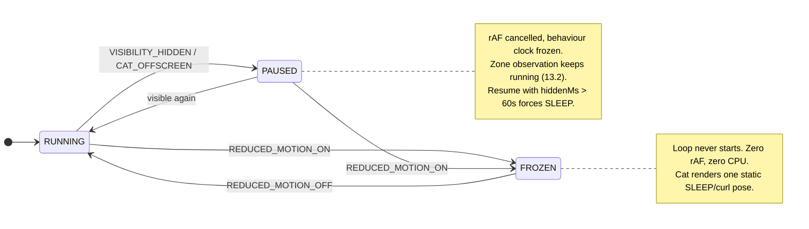
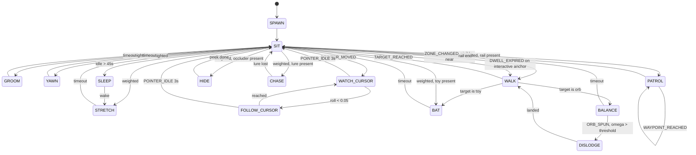

# Cat System — Architecture

**Phase:** 1 · **Owner:** Yarish

**Status:**
- §14 **Interaction anchor architecture — implemented** in `src/cat/world/`. 33 anchors
  discovered across all 9 zones; verified live (see §14.2.1).
- §0.1 **Anchor migration — done.** All 14 `data-cat-anchor` hooks removed; 3 empty divs
  deleted. The page contains no reference to the cat.
- **v1 behaviour — implemented.** Five states only: `SPAWN · SIT · SLEEP · WALK · WATCH`,
  plus modes, section transitions, reduced-motion and pause. Ships as a 5.9KB gz lazy chunk.
- **Not implemented** (designed above, additive): `STRETCH` `GROOM` `YAWN` `FOLLOW_CURSOR`
  `PATROL` `BAT` `HIDE` `BALANCE` `DISLODGE` `CHASE`. None require reworking v1.

**Corrections the implementation forced on this document — read before extending:**

1. **§13.2 is not optional, and I got it wrong first.** Queueing `ZONE_CHANGED` for the tick
   deadlocks: cat scrolls off-screen → loop pauses → zone event never drains → cat never
   relocates → never re-enters view → loop never restarts. Relocation MUST run outside the
   loop. `cat.ts:pump()`.
2. **Pick-weight is not time-share.** §8.2's `hero: SLEEP 25` measured at **~85% asleep**,
   because SLEEP lasts ~8× a SIT. A sleeping cat ignores the cursor by design, so
   watch-cursor became undiscoverable. Weights in `machine/states.ts` are retuned to yield
   roughly SIT 44% / WALK 38% / SLEEP 18% — **measured, not reasoned**. Always verify a
   weight change by sampling `__atlasCat.debug()`.
3. **"Idle" in `SIT → SLEEP: idle > 45s` means the *visitor* is idle**, not the cat. Keyed to
   the cat's own stillness, its wandering resets the timer and the rule never fires. Tracks
   pointermove/scroll/touch/keydown, so touch devices can satisfy it too.
4. **WALK is transit, never a destination.** §5 calls it "moving toward a new resting spot".
   Implemented as `WALK { then: SIT|SLEEP }`; without it, every ambient re-pick teleports.
5. **`rail` and `waypoint` must be sittable.** With SIT accepting only floor/ledge/bed/perch,
   the timeline exposes nothing any v1 state wants and the cat falls through to the synthetic
   floor — the safety net firing on a healthy section.
6. **The nav rail needs `edge: 'bottom'`.** Default `top` resolves it to y=0, the top of the
   document. §9.3 always said the header's baseline; the map now says so explicitly.

**Decisions taken since drafting:**
- Accent stays **blue** (`#34406b`). A deliberate override of brief §4's amber. Paw prints
  will use the blue accent. Closed — do not re-raise.
- Hero is **text + cat only** per brief §2.2. The dashed `visualSlot` has been removed; the
  hero's right-hand space is the cat's.

Source of truth for behaviour: `PastedMarkdown.md` §2 (non-negotiables), §5 (FSM), §7 (avoid-list).
This document is the design that satisfies it. Code comes after sign-off.

---

## 0. The one rule everything else follows

> The homepage does not know the cat exists. The cat knows the homepage exists.

Enforced as a **dependency direction**, not a vibe:

- No file under `src/sections/**` or `src/components/**` may import from `src/cat/**`.
- No section may contain the word "cat" — in an attribute, class, comment, or type.
- Deleting `src/cat/` entirely must leave the homepage byte-identical in render output.
- The cat's knowledge of the homepage is confined to **exactly one file**: `src/cat/world/map.ts`.
  A homepage redesign is a one-file change for the cat.

The cat is a *resident*, not a *feature*. It observes the page the way a real cat observes a
room: by looking at it, not by being told about it.

### 0.1 This requires undoing work already shipped

The current build has **14** `data-cat-anchor` attributes (verified by DOM count: `walk`×2,
`stop`×5, `pin`×2, `hide`, `paw-prints`, `portrait`, `globe`, `rest`) across Projects, About,
Timeline, Globe and Footer. **Every one of them violates the rule above** — the attribute
literally names the cat. Three of them are empty `<div>`s that exist for no other purpose.

The migration *removes* DOM rather than adding it:

| Today (violates) | Where | Becomes |
| --- | --- | --- |
| `data-cat-anchor="walk"` (empty div) | Projects | **deleted** — rail inferred from `#projects article` top edges |
| `data-cat-anchor="paw-prints"` (empty div) | Projects | **deleted** — trail is a render effect, not an anchor |
| `data-cat-anchor="hide"` | Momentum thumb | **deleted** — any `#projects article` is an occluder |
| `data-cat-anchor="walk"` | Timeline `<ol>` | **deleted** — `#timeline ol` is already semantic |
| `data-cat-anchor="stop"` ×5 | Timeline `<li>` | **deleted** — `#timeline li` is already semantic |
| `data-cat-anchor="rest"` (empty div) | Footer | **deleted** — `footer` is already semantic |
| `data-cat-anchor="portrait"` | About | `data-portrait` |
| `data-cat-anchor="globe"` | Globe wrapper | **deleted** — `#location canvas` is the orb |
| `data-cat-anchor="pin"` | Globe ×2 | `data-globe-pin` |

Net: **14 cat-named hooks → 2 self-descriptive ones, 3 empty divs removed.**

`data-portrait` and `data-globe-pin` describe *what the element is*, not what a cat does with it.
A tooltip or a label could use either. That is the test for whether a hook is legitimate:
**would this attribute still make sense if the cat were never built?**

One new hook is needed: `data-stack-item` on each `#stack` entry (its classes are CSS-Module
hashed and therefore unselectable). Alternative, preferred: make `#stack` a real `<ul>/<li>` —
correct semantics regardless of the cat, and then no attribute is needed at all.

---

## 1. Module structure

```
src/cat/
  index.ts              # lazy entry point; mounts CatLayer after first paint
  CatLayer.tsx          # the single overlay node. aria-hidden, pointer-events:none

  world/
    map.ts              # ★ THE ONLY FILE THAT NAMES THE HOMEPAGE
    world.ts            # discovery · measurement · indexing · invalidation
    zones.ts            # zone ids + dominant-zone observer
    rails.ts            # synthesises walkable lines from discovered rects

  machine/
    states.ts           # state ids + per-state config (duration, interruptible, needs)
    transitions.ts      # the transition table
    weights.ts          # per-zone probability weights
    machine.ts          # pure reducer: (state, event, ctx) -> state

  runtime/
    loop.ts             # rAF driver, 30Hz accumulator, start/stop
    clock.ts            # behaviour clock (pausable, freezable)
    bus.ts              # event queue + priority sort
    sources.ts          # DOM event sources -> CatEvent
    pointer.ts          # pointer tracking + orb-spin derivation

  render/
    poses.ts            # state+variant -> pose frame
    renderer.ts         # writes transform/data-pose. never re-renders React
    pawTrail.ts         # pooled nodes, CSS-only fade

  policy/
    motion.ts           # prefers-reduced-motion
    device.ts           # viewport class + pointer class
```

`machine/` is **pure**: no DOM, no timers, no randomness (RNG is injected). That makes the whole
behaviour layer unit-testable and deterministic with a seeded RNG.

---

## 2. Finite State Machine

### 2.1 Modes (gate the machine; not states)

The brief says reduced-motion should *"skip the FSM loop entirely"* — so freezing is a **mode**,
not a state. Modes wrap the machine:

| Mode | Trigger | Loop | Behaviour clock |
| --- | --- | --- | --- |
| `RUNNING` | default | rAF active | ticking |
| `PAUSED` | tab hidden · cat off-screen | `cancelAnimationFrame` | **frozen** |
| `FROZEN` | `prefers-reduced-motion: reduce` | never started | never started |

`PAUSED` freezes the clock rather than letting it run: a tab hidden for 10 minutes must not
return and fire 600 queued timeouts.

### 2.2 States — 15

States are **verbs**. Anchors supply the nouns. This is the core of layout-independence:
"sleep under the hero heading", "sleep on the portrait" and "curl up in the footer" are
**one state** (`SLEEP`) at three anchors — not three behaviours.

| # | State | Band | Needs affordance | Interruptible | Mobile |
| --- | --- | --- | --- | --- | --- |
| 1 | `SPAWN` | meta | any | no | ✓ |
| 2 | `SIT` | rest | floor · perch · bed · ledge | ✓ | ✓ |
| 3 | `SLEEP` | rest | floor · bed · den | ✓ | ✓ |
| 4 | `STRETCH` | rest | floor · bed · ledge | ✓ | ✓ |
| 5 | `GROOM` | rest | floor · bed · ledge | ✓ | ✓ |
| 6 | `YAWN` | rest | any restable | ✓ | ✓ |
| 7 | `WATCH_CURSOR` | attention | any restable | ✓ | fine-pointer only |
| 8 | `FOLLOW_CURSOR` | attention | floor | ✓ | ✗ |
| 9 | `WALK` | locomotion | floor (path) | ✓ | ✗ cross-zone |
| 10 | `PATROL` | locomotion | rail + waypoints | ✓ | ✗ |
| 11 | `BAT` | play | toy | ✓ | ✓ (local) |
| 12 | `HIDE` | play | occluder | ✓ | ✓ (local) |
| 13 | `BALANCE` | orb | orb | ✓ | ✗ |
| 14 | `DISLODGE` | orb | orb | **no** | ✗ |
| 15 | `CHASE` | play | floor + lure | ✓ | ✗ |

**Poses are not states.** The brief's richer verbs are rendering variants, which also maps
cleanly onto the "10–15 static poses" art deliverable:

| State | Variants (poses) |
| --- | --- |
| `SLEEP` | `curl` · `roll-over` · `belly-up` |
| `BAT` | `swat` · `nudge` · `scratch` |
| `SIT` | `sit` · `sit-tall` · `loaf` |
| `PATROL` | `walk-a` · `walk-b` · `look-around` (at waypoints) |
| `DISLODGE` | `slide` · `jump-off` (severity-selected) |

This keeps the machine at 15 states (brief §3: *"~12–15 states"*) while delivering every
behaviour in the §5 table.

### 2.3 State config shape (specification, not code)

```ts
type StateConfig = {
  id: StateId
  band: 'meta' | 'rest' | 'attention' | 'locomotion' | 'play' | 'orb'
  needs: Affordance[]          // eligibility: zone must expose one of these
  duration: [minMs, maxMs]     // sampled on entry
  interruptible: boolean
  priority: Priority           // what it can refuse to yield to
  mobile: boolean | 'finePointerOnly'
  cooldownMs?: number          // min gap before this state may repeat
}
```

---

## 3. State diagram

### 3.1 Modes



### 3.2 States (all within `RUNNING`)



`SIT` is the hub — every state returns through it, which keeps the graph tractable and means
there is exactly one place that runs the weighted pick.

Two edges carry most of the character:

- `SIT --> SLEEP : idle > 45s` — the cat settles if you leave it alone.
- `PAUSED --> SLEEP : hidden > 60s` — come back after a while and it has fallen asleep.
  Costs nothing, and it is the single most "alive" detail in the system.

---

## 4. Transition table

`P` = priority band (§6). Lower number wins. Guards are evaluated in order; first match fires.

### 4.1 Forced — P0

| From | Event | Guard | To | Notes |
| --- | --- | --- | --- | --- |
| _any_ | `REDUCED_MOTION_ON` | — | `FROZEN` mode | loop never runs |
| `FROZEN` | `REDUCED_MOTION_OFF` | — | `SPAWN` | live matchMedia, not load-time |
| _any_ | `VISIBILITY_HIDDEN` | — | `PAUSED` mode | clock freezes |
| _any_ | `CAT_OFFSCREEN` | — | `PAUSED` mode | IO on the cat node |
| `PAUSED` | `VISIBILITY_VISIBLE` | `hiddenMs > 60_000` | `SLEEP` | woke up somewhere else |
| `PAUSED` | `VISIBILITY_VISIBLE` | else | resume prior | clock unfreezes |
| `PAUSED` | `CAT_ONSCREEN` | — | resume prior | |

### 4.2 Policy — P1

| From | Event | Guard | To | Notes |
| --- | --- | --- | --- | --- |
| `SIT` | `DWELL_EXPIRED` | anchor.interactive | `WALK` | §5: max 4–6s on Resume |
| _any_ | `ANCHOR_LOST` | target removed from DOM | `WALK` → nearest valid | never strand |
| _any_ | `ANCHORS_INVALIDATED` | target rect moved > 24px | re-target in place | resize/reflow |
| _any_ | `NO_ANCHORS` | zone exposes none | `SIT` @ synthetic floor | see §12.4 |

### 4.3 World — P2

| From | Event | Guard | To | Notes |
| --- | --- | --- | --- | --- |
| _any_ | `ZONE_CHANGED` | `!catVisible` | `SPAWN` in new zone | **silent teleport** (§9.2) |
| _any_ | `ZONE_CHANGED` | `catVisible && desktop && dist < 1.5vh` | `WALK` to new zone | the cat follows you |
| _any_ | `ZONE_CHANGED` | `catVisible && (mobile ‖ far)` | _no change_ | wait until unobserved |
| _any_ | `VIEWPORT_CLASS_CHANGED` | now mobile | re-evaluate eligibility | drop roaming states |

### 4.4 Reactive — P3

| From | Event | Guard | To | Notes |
| --- | --- | --- | --- | --- |
| `BALANCE` | `ORB_SPUN` | `|ω| > SLIDE_ω` | `DISLODGE` (`slide`) | |
| `BALANCE` | `ORB_SPUN` | `|ω| > EJECT_ω` | `DISLODGE` (`jump-off`) | |
| `DISLODGE` | _any_ | — | _refused_ | **not interruptible** |
| rest\* | `POINTER_MOVED` | fine pointer && near | `WATCH_CURSOR` | head only |
| `WATCH_CURSOR` | `POINTER_MOVED` | `roll() < 0.05` | `FOLLOW_CURSOR` | rare |
| `WATCH_CURSOR` | `POINTER_IDLE` | 3s | → weighted pick | loses interest |
| `FOLLOW_CURSOR` | `POINTER_IDLE` | 3s | `SIT` | |
| _any_ | `SCROLL_STARTED` | `velocity > fast` | _no change_ | cat never gates scroll |

\* rest = `SIT` · `GROOM` · `STRETCH` · `YAWN` (not `SLEEP` — a sleeping cat ignores you)

### 4.5 Scheduled — P4

| From | Event | Guard | To |
| --- | --- | --- | --- |
| _any interruptible_ | `STATE_TIMEOUT` | — | weighted pick (§7) |
| `SIT` | `STATE_TIMEOUT` | `idleMs > 45_000` | `SLEEP` |
| `PATROL` | `WAYPOINT_REACHED` | more waypoints | `PATROL` (pose `look-around`) |
| `PATROL` | `WAYPOINT_REACHED` | last | `SIT` |
| `WALK` | `TARGET_REACHED` | target.affordance = `toy` | `BAT` |
| `WALK` | `TARGET_REACHED` | target.affordance = `orb` | `BALANCE` |
| `WALK` | `TARGET_REACHED` | else | `SIT` |

---

## 5. Event system

### 5.1 Envelope

```ts
type CatEvent =
  | { t: 'TICK'; dt: number }
  | { t: 'ZONE_CHANGED'; zone: ZoneId }
  | { t: 'POINTER_MOVED'; at: DocPoint; fine: boolean }
  | { t: 'POINTER_IDLE' }
  | { t: 'SCROLL_STARTED' | 'SCROLL_ENDED'; velocity: number }
  | { t: 'ORB_SPUN'; omega: number }          // derived, not received (§5.3)
  | { t: 'VISIBILITY_HIDDEN' | 'VISIBILITY_VISIBLE'; hiddenMs?: number }
  | { t: 'CAT_OFFSCREEN' | 'CAT_ONSCREEN' }
  | { t: 'REDUCED_MOTION_ON' | 'REDUCED_MOTION_OFF' }
  | { t: 'VIEWPORT_CLASS_CHANGED'; klass: 'mobile' | 'desktop' }
  | { t: 'ANCHORS_INVALIDATED' } | { t: 'ANCHOR_LOST'; id: AnchorId }
  | { t: 'STATE_TIMEOUT' | 'DWELL_EXPIRED' | 'TARGET_REACHED' | 'WAYPOINT_REACHED' }
```

The bus is a **priority queue drained once per tick**, not an emitter. Synchronous emitters
would let a `pointermove` storm re-enter the machine mid-transition. One drain per tick, highest
priority first, at most one transition per tick.

### 5.2 Sources — all owned by the cat

| Source | Listens to | Emits | Cost control |
| --- | --- | --- | --- |
| `zones.ts` | `IntersectionObserver(sections)` | `ZONE_CHANGED` | runs **outside** the rAF loop — must work while paused |
| `pointer.ts` | `pointermove` on `window` | `POINTER_MOVED` | throttled to tick rate; `{passive:true}` |
| `sources.ts` | `scroll` | `SCROLL_*` | `{passive:true}`, debounced 120ms |
| `sources.ts` | `visibilitychange` | `VISIBILITY_*` | — |
| `sources.ts` | `IntersectionObserver(catNode)` | `CAT_*SCREEN` | — |
| `motion.ts` | `matchMedia(prefers-reduced-motion)` | `REDUCED_MOTION_*` | live listener, not a load-time read |
| `device.ts` | `matchMedia(max-width:767px)`, `(pointer:coarse)` | `VIEWPORT_CLASS_CHANGED` | two independent axes |
| `world.ts` | `ResizeObserver(body)` + `MutationObserver(main)` | `ANCHORS_INVALIDATED` | debounced 150ms |

Every listener is registered by the cat, on `window`/`document`/discovered nodes.
**No section ever emits anything.**

### 5.3 The globe problem, and why the cat derives spin

§5 requires *"slides if spun fast, jumps off if spun aggressively"* — the cat needs the orb's
angular velocity. The obvious solution (`Globe` emits `onSpin`) **breaks rule 0**: the Globe
would know a cat exists.

**Resolution: the cat derives ω itself.** It already tracks the pointer. If the pointer is
down and inside the orb anchor's rect, it computes `ω ≈ dx/dt ÷ radius` — the same quantity
`Globe.tsx` computes internally from the same input. Zero coupling. The cat *sees* the ball
spinning; it isn't told.

This works because our Globe has no release inertia (rotation is driven directly by pointer
delta). **If inertia is ever added**, the derivation goes stale after pointer-up, and the escape
hatch is: `Globe` exposes a neutral `data-angular-velocity` readout describing *itself* — still
cat-agnostic, usable by anything. Documented now so the decision isn't re-litigated later.

---

## 6. Timing system

### 6.1 Two clocks

| Clock | Drives | Source | Pauses? |
| --- | --- | --- | --- |
| **Frame clock** | interpolation, sprite frames | `requestAnimationFrame` | yes — `cancelAnimationFrame` |
| **Behaviour clock** | state durations, dwell, cooldowns | `performance.now()` minus accumulated pause | **freezes** |

Durations are compared as `clock.now() - state.enteredAt > state.duration`, never counted in
frames. A dropped frame must not slow the cat's life down; a hidden tab must not speed it up.

### 6.2 Tick rate

**30Hz**, via accumulator inside a 60Hz rAF (`if (acc < 33.3) return`). The cat is a background
actor; 30Hz is indistinguishable for this motion vocabulary and halves the CPU. Sprite frames
are 8–12fps regardless.

### 6.3 Constants

| Constant | Value | Source |
| --- | --- | --- |
| `TICK_MS` | 33.3 (30Hz) | perf budget |
| `IDLE_DURATION` | 4 000 – 12 000ms | ambient pacing |
| `MICRO_DURATION` | 700 – 1 600ms | stretch/yawn/groom |
| `INTERACTIVE_MAX_DWELL` | **5 000ms** | §5: "max dwell 4–6s on Resume" |
| `SLEEP_AFTER_IDLE` | 45 000ms | build-plan §6: "curls up after ~45s idle" |
| `HIDDEN_SLEEP_THRESHOLD` | 60 000ms | design call — see §3 |
| `POINTER_IDLE_MS` | 3 000ms | attention span |
| `WALK_SPEED` | ~60 px/s | plausibility |
| `PATROL_STOP` | 800 – 1 500ms | §5: "stops at each milestone, looks around" |
| `PAW_TRAIL_FADE` | **3 000ms** | §5: "fade over ~3s" |
| `RUN_ACROSS_MAX` | 1 / session | build-plan §6: "rare, once per session max" |
| `REPLACE_COOLDOWN` | 1 500ms | anti-flicker on fast scroll |
| `SPIN_SLIDE_ω` / `SPIN_EJECT_ω` | tune on real input | §5 |

All durations are sampled per-entry from their range — never a fixed value. A cat that grooms
for exactly 1 200ms every time is a machine.

---

## 7. Priority rules

### 7.1 Bands

> §5: *"User scroll/hover/click always wins — the cat reacts to it, never gates it."*

| P | Band | Can interrupt | Examples |
| --- | --- | --- | --- |
| **0** | Forced | everything, incl. `DISLODGE` | reduced-motion, visibility |
| **1** | Policy | everything except P0 | max-dwell expiry, anchor lost |
| **2** | World | interruptible states | zone change, viewport class |
| **3** | Reactive | interruptible states | orb spun, pointer moved |
| **4** | Scheduled | self only | state timeout |
| **5** | Ambient | nothing | weighted idle pick |

### 7.2 The interrupt rule

```
may_interrupt(event, state) =
     event.priority <= 1              // P0/P1 always win
  || state.interruptible              // otherwise state must consent
```

`DISLODGE` is the only non-interruptible state — a cat mid-fall cannot decide to groom.
It still yields to P0/P1, because correctness beats character.

### 7.3 Structural guarantee

Priority governs *behaviour*, never *input*. The cat physically cannot intercept a click:
the layer is `pointer-events: none` + `aria-hidden="true"` (§2.4: *"structurally impossible…
don't rely on the FSM choosing to move away"*). The FSM's dwell caps are about **plausibility**
(a cat shouldn't loiter on a button), not about safety. Safety is CSS. Two independent
mechanisms; the FSM is never load-bearing for accessibility.

---

## 8. Probability weights

Selection = filter to **eligible** states, then weighted pick.

```
eligible(s) = zone exposes an affordance in s.needs
            && (desktop || s.mobile === true || (s.mobile === 'finePointerOnly' && hasFinePointer))
            && clock.now() - lastExit[s] > s.cooldownMs
```

Weights are `number | (ctx) => number`. Per-zone, because the brief specs per-section behaviour.

### 8.1 Global fallback (zone with no table)

| State | Weight |
| --- | --- |
| `SIT` | 30 |
| `GROOM` | 15 |
| `WATCH_CURSOR` | 15 |
| `SLEEP` | 15 |
| `STRETCH` | 10 |
| `YAWN` | 8 |
| `WALK` | 5 |
| `BAT` | **2** |

§5 calls playful *"rare, short"* — weight 2 of ~100.

### 8.2 Per-zone

| Zone | Weights | Brief §5 |
| --- | --- | --- |
| **nav** | `PATROL` 60 · `SIT`(perch) 40 | walk across, occasional sit-on-Resume |
| **hero** | `WATCH_CURSOR` 25 · `SLEEP` 25 · `STRETCH` 15 · `YAWN` 10 · `GROOM` 10 · `SIT` 10 · `FOLLOW_CURSOR` 5 | sleep under heading, stretch, watch, follow, yawn |
| **stack** | `BAT` 40 · `SIT` 35 · `GROOM` 15 · `WATCH_CURSOR` 10 | bat an icon, sit between icons, nudge |
| **projects** | `PATROL` 40 · `HIDE` 25 · `SIT` 20 · `GROOM` 15 | walk card tops, hide behind, paw trail |
| **about** | `SLEEP` 40 (`curl`/`roll-over`) · `SIT` 20 · `BAT` 20 (`scratch`) · `GROOM` 20 | sleep on portrait, roll over, scratch frame |
| **timeline** | `PATROL` 70 · `SIT` 20 · `GROOM` 10 | walkway, stops at milestones |
| **globe** | `BALANCE` 60 · `BAT` 25 (pins) · `SIT` 15 | **the one big playful moment** |
| **contact** | `SLEEP` f(t) · `SIT` 30 · `CHASE` 20 · `GROOM` 10 | chases plane, sits near email, eventually sleeps |

### 8.3 The one dynamic weight

§5: footer sleep is *"the resting end-state after prolonged time on page."*

```
weight(SLEEP @ contact) = clamp(20 + timeOnPageMs / 10_000, 20, 120)
```

At 0s it's one option among several; after ~15 min it dominates. The cat winds down as the
visit goes on — encoded, not scripted.

---

## 9. Desktop behaviour

Full state set. The cat is a continuous resident of document space.

### 9.1 Coordinate space

The cat lives in **document space**; it is rendered in **viewport space**.

```
screenY = anchor.docY - window.scrollY
```

Anchors are stored as `docY = rect.top + scrollY`. Consequence: **scrolling never invalidates
the world model.** Only resize and DOM mutation do. This is what makes a 30Hz loop affordable.

### 9.2 Relocation, and the illusion

The cat cannot plausibly walk hero → footer when you flick-scroll. So:

> **Relocation is only legal while unobserved.**

| Situation | Action |
| --- | --- |
| Zone changed, cat off-screen | **silent teleport** to an entry anchor in the new zone |
| Zone changed, cat visible, adjacent | `WALK` — the cat follows you |
| Zone changed, cat visible, far | do nothing; wait until it leaves the viewport |

The cat is never seen to teleport, so it reads as one continuous animal. `REPLACE_COOLDOWN`
prevents flicker during fast scrubbing.

### 9.3 Rails are inferred, not declared

`PATROL` needs a line to walk. The cat **synthesises** it (`world/rails.ts`) from discovered
geometry:

- **projects** — sort `#projects article` rects by `x`; the rail is the sequence of their top
  edges; waypoints are card centres.
- **timeline** — the rail is `#timeline ol`'s top border; waypoints are each `li`'s centre-x.
- **nav** — the rail is `header`'s bottom edge; the Resume link is a perch waypoint.

The page never says "here is a walkway". The cat looks at three cards and concludes their top
edges form a line. This is precisely why the `catWalkway` div gets deleted.

---

## 10. Mobile behaviour

> §2.6: *"Mobile has its own cat behavior set, decided now, not bolted on later."*
> §5: *"disable walk-transit between distant sections and the globe-balance physics; keep sleep,
> stretch, watch-cursor, and section-local behaviors (sit-in-place, groom) only."*

### 10.1 Two independent axes

Conflating "small screen" with "touch" is wrong — hybrids exist.

| Axis | Query | Governs |
| --- | --- | --- |
| **viewport class** | `(max-width: 767px)` — our `md` breakpoint | roaming budget |
| **pointer class** | `(pointer: fine)` | cursor-dependent states |

### 10.2 Eligibility

| State | Mobile | Why |
| --- | --- | --- |
| `SIT` `SLEEP` `STRETCH` `GROOM` `YAWN` | ✓ | section-local, no roaming |
| `BAT` `HIDE` | ✓ | local to one anchor |
| `WATCH_CURSOR` | **fine-pointer only** | see below |
| `WALK` | local only (≤ 1 zone) | no cross-page roaming |
| `PATROL` `BALANCE` `DISLODGE` `FOLLOW_CURSOR` `CHASE` | ✗ | §5 |

Relocation on mobile is **always** silent teleport — never `WALK`.

### 10.3 One deliberate deviation from the brief

§5 lists `watch-cursor` as mobile-eligible. **On a touch device there is no cursor to watch** —
`pointermove` never fires, so the state would be selected and then render a cat staring at a
stale coordinate. Following the brief literally produces a bug.

**Decision:** `WATCH_CURSOR` is gated on `(pointer: fine)`, not on viewport. A phone gets
weight 0; a small laptop window keeps it; a tablet with a trackpad keeps it. This honours the
*intent* (keep the calm attentive states on small screens) while not shipping a cat that
watches a ghost. Flagged rather than silently "fixed".

---

## 11. Reduced-motion behaviour

> §2.5: *"the cat freezes in a single idle pose (no walking, no globe physics) rather than just
> moving slower."* §5: *"force sleep permanently, skip the FSM loop entirely."*

| Aspect | Behaviour |
| --- | --- |
| Mode | `FROZEN` |
| Loop | **never started.** Not throttled — zero rAF, zero CPU |
| State | `SLEEP`, pose `curl`, permanently |
| Position | deterministic: first `bed`\|`floor` anchor in the hero zone; fallback synthetic floor |
| Paw trail | never rendered |
| Globe | already compliant — auto-rotation off, drag preserved *(verified: two frames 1.2s apart byte-identical)* |
| Toggle | live `matchMedia` listener. Turning it on mid-session freezes immediately; turning it off spawns the cat |

The frozen position must not depend on FSM history — a user who enables reduced motion should
get the same result as one who loaded with it on. Determinism, not last-known-state.

Note: `FROZEN` is *not* a state in the table — it's the absence of the machine. That's what
"skip the FSM loop entirely" means, and it's why modes exist (§2.1).

---

## 12. Performance strategy

> §2.7 + §8: the cat and globe must not push hero LCP past ~2s throttled.

### 12.1 Budget

| Metric | Budget |
| --- | --- |
| Cat JS | **< 15KB gz** (globe is already 6.74KB gz, code-split) |
| Frame cost | **< 1.5ms** @ 30Hz |
| LCP contribution | **0** — nothing loads before first paint |
| Layout thrash | **0** — no reads after the batched measure |

### 12.2 Loading

The cat is **not** in the initial bundle. `index.ts` is dynamically imported on
`requestIdleCallback` (fallback `setTimeout 200ms`) after first paint. The cat then walks in
from a viewport edge — arriving late is in character, and it costs LCP nothing.

### 12.3 The frame

- **One** rAF for the entire system. Not one per concern.
- **React never re-renders per frame.** The renderer writes `transform: translate3d()` and a
  `data-pose` attribute directly to a node held by ref. React's involvement ends at mount.
  Pose → sprite is CSS (`[data-pose="curl"] { background-position: … }`).
- **Read/write separation.** All `getBoundingClientRect()` happen in the invalidation pass
  (debounced 150ms), never inside the tick. The tick only writes. No forced reflow, ever.
- `will-change: transform` applied **only while moving**, removed at rest — a permanent
  compositor layer for a sleeping cat is a waste of GPU memory.
- `contain: layout style paint` on the layer.
- Paw prints: **pooled** (max 8 nodes, ring buffer). Spawn = reposition + restart a CSS opacity
  transition. Zero per-frame JS, zero allocation.
- Sprite sheet, not per-frame DOM. Lottie is the fallback if the art arrives rigged — note it's
  ~40KB+ runtime and would blow the budget above; sprite sheet is the default.

### 12.4 Never stranded

If discovery returns nothing (page changed, sections renamed, JS partially failed), the world
model synthesises one anchor: **`floor` = the viewport's bottom edge**. It always exists, needs
no DOM, and guarantees the cat has somewhere to be. The cat degrades to `SIT`/`SLEEP`/`GROOM`
on an empty page rather than throwing or vanishing.

This is the practical meaning of *"completely independent from the page layout."*

---

## 13. Visibility handling

> §2.7: *"stop the update loop on visibilitychange (tab hidden) and when the cat's container
> leaves the viewport (IntersectionObserver)."*

### 13.1 Two independent stop conditions

| Signal | Mechanism | Effect |
| --- | --- | --- |
| Tab hidden | `document.visibilitychange` | `cancelAnimationFrame`, freeze clock |
| Cat off-screen | `IntersectionObserver(catNode, threshold 0)` | `cancelAnimationFrame`, freeze clock |

Either is sufficient to pause. Both must clear to resume.

### 13.2 What must keep running while paused

This is the subtle part. **Zone observation must survive the pause**, or the cat can never be
relocated to where you scrolled:

```
1. user scrolls hero → projects
2. cat leaves viewport      → CAT_OFFSCREEN  → loop stops        ✔ cheap
3. ZONE_CHANGED(projects)   → fires anyway (IO is not the loop)  ← must work
4. cat off-screen + zone changed → silent teleport (§9.2)
5. cat node enters viewport → CAT_ONSCREEN   → loop restarts
```

So `ZONE_CHANGED` handling and the relocation decision live **outside** the rAF loop — they are
event-driven and cost nothing. Only *simulation* pauses; *observation* does not.

### 13.3 Return-from-hidden

`hiddenMs > 60s` → force `SLEEP` (§3). Because the behaviour clock froze, no timeouts are
queued and nothing catches up. The cat simply was asleep while you were gone.

---

## 14. Interaction anchor architecture

### 14.1 Affordance vocabulary

Anchors describe **physical affordances**, not cat behaviours. `SLEEP` doesn't ask for "the
portrait"; it asks for *a bed*. Swap the portrait for a rug and nothing in the machine changes.

| Affordance | Physical meaning | Enables |
| --- | --- | --- |
| `floor` | broad region that can be occupied | `SIT` `SLEEP` `STRETCH` `GROOM` `YAWN` `WALK` `FOLLOW_CURSOR` |
| `ledge` | flat top edge, walkable | `PATROL` `SIT` `STRETCH` |
| `rail` | line with ordered waypoints | `PATROL` |
| `waypoint` | point of interest on a rail | `PATROL` stop |
| `perch` | small elevated spot | `SIT` (dwell-capped) |
| `bed` | soft surface | `SLEEP` `SIT` |
| `toy` | small, battable | `BAT` |
| `occluder` | has a behind | `HIDE` |
| `orb` | spherical, spinnable | `BALANCE` `DISLODGE` |
| `den` | terminal rest | `SLEEP` end-state |
| `lure` | moving thing worth chasing | `CHASE` |

### 14.2 The world map — the only file that knows the homepage

```ts
// src/cat/world/map.ts   ← the entire coupling surface
export const WORLD: AnchorSpec[] = [
  { zone: 'nav',      selector: 'header',                     affordance: 'rail'     },
  { zone: 'nav',      selector: 'header a[href$=".pdf"]',     affordance: 'perch',
                      policy: { interactive: true, maxDwellMs: 5000 } },

  { zone: 'hero',     selector: '#top h1',                    affordance: 'floor',
                      anchorTo: 'below' },                    // "sleep under heading"
  { zone: 'hero',     selector: '#top',                       affordance: 'floor'    },

  { zone: 'stack',    selector: '#stack [data-stack-item]',   affordance: 'toy'      },

  { zone: 'projects', selector: '#projects article',          affordance: 'ledge'    },
  { zone: 'projects', selector: '#projects article',          affordance: 'occluder' },

  { zone: 'about',    selector: '#about [data-portrait]',     affordance: 'bed'      },

  { zone: 'timeline', selector: '#timeline ol',               affordance: 'rail'     },
  { zone: 'timeline', selector: '#timeline li',               affordance: 'waypoint' },

  { zone: 'globe',    selector: '#location canvas',           affordance: 'orb'      },
  { zone: 'globe',    selector: '#location [data-globe-pin]', affordance: 'toy'      },

  { zone: 'contact',  selector: '#contact a[href^="mailto:"]', affordance: 'perch',
                      policy: { interactive: true, maxDwellMs: 5000 } },
  { zone: 'contact',  selector: 'footer',                     affordance: 'den'      },
]
```

Eleven of fourteen entries use **selectors the page already has for its own reasons** — section
ids, `article`, `li`, `canvas`, `a[href^="mailto:"]`. Only `data-portrait`, `data-globe-pin`
and `data-stack-item` are hooks, and all three describe the element rather than the cat.

### 14.2.1 Resolution — verified against the live DOM, not assumed

Run against `localhost:5173` with every section scrolled into view:

| Zone | Affordance | Selector | Matches |
| --- | --- | --- | --- |
| nav | `rail` | `header` | **1** |
| nav | `perch` | `header a[href$=".pdf"]` | **1** |
| hero | `floor` (below) | `#top h1` | **1** |
| hero | `floor` | `#top` | **1** |
| stack | `toy` | `#stack [data-stack-item]` | **0** ← hook needed |
| projects | `ledge` | `#projects article` | **3** |
| projects | `occluder` | `#projects article` | **3** |
| about | `bed` | `#about [data-portrait]` | **0** ← rename from `data-cat-anchor` |
| timeline | `rail` | `#timeline ol` | **1** |
| timeline | `waypoint` | `#timeline li` | **5** |
| globe | `orb` | `#location canvas` | **1** |
| globe | `toy` | `#location [data-globe-pin]` | **0** ← rename from `data-cat-anchor` |
| contact | `perch` | `#contact a[href^="mailto:"]` | **2** |
| contact | `den` | `footer` | **1** |

**11/14 resolve today with zero page changes.** The three misses are exactly the three hooks
listed in §0.1 — two are renames, one is new. Nothing in the design depends on a selector that
doesn't exist.

`#contact a[href^="mailto:"]` matching **2** is correct and desirable: the visible address and
the "Email me" button are two distinct perches near the email. Both are interactive, so both
inherit the 5s dwell cap automatically from the spec's policy — no special-casing.

Timeline yields **5** waypoints, matching the 2022–2026 milestones. Add a year and the rail
grows a stop with no code change (§14.6).

### 14.3 Anchor shape

```ts
type Anchor = {
  id: AnchorId              // `${zone}:${affordance}:${i}` — stable across re-discovery
  el: Element               // live ref; presence re-checked on invalidate
  affordance: Affordance
  zone: ZoneId
  rect: DocRect             // DOCUMENT space (§9.1) — scroll-invariant
  surfaceY: number          // the line the cat stands on (rect.top for ledge/rail)
  policy: { interactive?: boolean; maxDwellMs?: number }
}
```

### 14.4 Discovery pipeline

```
resolve()     querySelectorAll per spec           → Element[]
measure()     getBoundingClientRect + scrollY     → DocRect   (batched, read-only phase)
index()       bucket by zone × affordance         → Map
invalidate()  ResizeObserver + MutationObserver, debounced 150ms → re-run
```

Never runs on scroll (§9.1). Never runs inside the tick (§12.3).

### 14.5 Query API — what the machine is allowed to ask

```ts
world.anchors({ zone, affordance }): Anchor[]
world.nearest(point, { affordance }): Anchor | null
world.rail(zone): Rail | null          // synthesised (§9.3)
world.dominantZone(): ZoneId
world.isVisible(anchor): boolean
world.floor(): Anchor                  // synthetic; never null (§12.4)
```

The machine may **only** address the world through affordances. It cannot ask for "the Momentum
card" — it asks for an occluder in the projects zone. That is the whole game: rename the
component, restyle it, reorder it, and the cat is unaffected. Delete the section and the cat
loses one affordance and picks something else.

### 14.6 Resilience matrix

| Change to the homepage | Cat impact |
| --- | --- |
| Restyle anything | none — geometry is measured, never assumed |
| Reorder sections | none — zones are discovered, order is not encoded |
| Rename a CSS-Module class | none — no class selectors used |
| Add a project card | rail grows a waypoint automatically |
| Delete a section | that zone's affordances vanish; weights renormalise over eligible states |
| Rebuild the whole page | edit `map.ts`. One file |
| Delete `src/cat/` | homepage byte-identical |

---

## 15. Open items before implementation

1. **Art.** 10–15 poses (§2.2 variants above) — brief §3 flags this as a parallel work item,
   not a blocker. Build against placeholder shapes first.
2. **Nav wordmark.** §2.1/§6 require name/initials, not "Atlas" — the codename belongs in the
   footer copyright only. Still unmet. Affects the nav rail's perch layout only trivially, but
   it is an explicit non-negotiable.
3. **`ω` thresholds** for slide vs eject — tune against real input; cannot be derived on paper.
4. **`#stack` semantics.** `<ul>/<li>` would remove the need for `data-stack-item` entirely and
   is a correctness win independent of the cat.
5. **`lure` has no source.** `CHASE` is specced with weight 20 in the contact zone, but the
   paper plane it chases was never built, so no `lure` anchor exists and the state can never
   become eligible. Either build the plane or drop `CHASE` from the state list.
6. **Overlay mount point.** `world.ts` ignores mutations inside `[data-cat-layer]` so the cat's
   own DOM cannot invalidate the world it reads. The layer must carry that attribute, and
   should mount outside the zone roots (portal to `body`).

**Closed:** paw-trail colour (blue, confirmed) · hero space (box removed, hero is text + cat).
